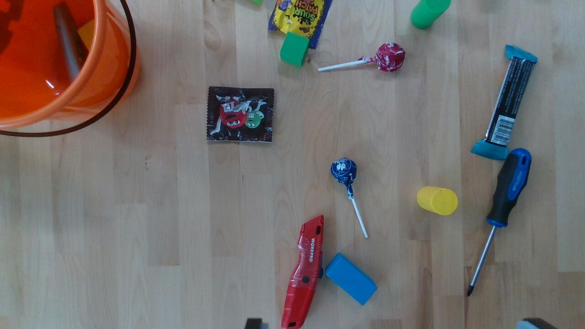

# Trick-or-Treat Sorter

**🥉 3rd place, Viam × MongoDB Robot Hackathon: Harnessing Physical AI & Data** (San Francisco, Oct 29–30, 2026, Robotics Center of Silicon Valley).

Type a list of everyday objects into one box, for example `red lollipop, blue block, m&m snack`. A UFactory xArm6 finds each one anywhere on a cluttered table, picks it up and drops it into a pumpkin bucket. The bucket can be moved at any time; the arm searches for it.

Nothing is trained for the objects. CLIP matches the words to what the wrist camera sees, and a library of object views in MongoDB Atlas, searched with `$vectorSearch`, helps it recognise the ones it has seen before.



## What it does

- **Open vocabulary.** Any description works, not a fixed class list. An open-set gate refuses to grab something that clearly isn't what was asked for, and a recognised object is never taken for another name.
- **Lists and a queue.** A comma-separated list becomes one job, run in order. Commands typed while the arm is busy are queued. If a name matches several objects (`lollipop`), all of them go in one after another.
- **Finds things anywhere.** It starts from the live table map, then searches by coverage: straight-down views plus tilted ones around the bucket, which otherwise blocks the view. It grasps at the first view that shows the object.
- **Movable drop target.** The orange bucket is located by colour and rim geometry, using its known size, so a partial view is enough. It is confirmed again over its mouth before the gripper opens.
- **Recovers.** A slip is detected from the picture and the jaw opening, not from the gripper's unreliable `holding()` alone. A failed try is retried in place, with no trip back to the start pose, and the wrist turns when a finger's landing spot is blocked. If the bucket truly can't be found, the object is put back where it was picked.
- **Smooth, fast moves.** With `SORTER_SMOOTH=1`, as run at the event, air moves are single quintic joint-space paths. The arm moves at 180°/s, and the camera loop runs at 2 Hz.
- **Operator controls.** The dashboard has exactly three things: the command box (with Grasp, Stop and Reset), the live arm camera with recognition boxes, and the robot's internal table map. Stop ends only the current task; the arm lifts, puts back what it holds and goes on with the queue.

## Architecture

```
dashboard (FastAPI)  ──DoCommand──▶  Viam module  sorter-team:sorter:grasp-by-description  (generic service, runs on the robot)
                                        │
                                        ├─ perception   RealSense D435 colour + depth → objects by height above the fitted table plane
                                        ├─ recognition  CLIP ViT-B-32 crop embeddings · open-set gate · in-memory mirror of the Atlas library
                                        ├─ planning     live table map · coverage search · candidate close looks · grasp primitives
                                        ├─ control      xArm6 + gripper through Viam · visual-servo refine · quintic joint paths
                                        └─ memory  ──▶  MongoDB Atlas
                                                         views (vector index views_vec) · attempts · observations
                                                         observation_images · clips · table_map · status
```

| Layer | Stack |
|---|---|
| Robot | UFactory xArm6 with its gripper, Intel RealSense D435 on the wrist |
| Robot software | Viam RDK, Python SDK, one packaged module (`meta.json`, `module/`) |
| Vision | depth segmentation (`sorter/perception.py`), CLIP ViT-B-32 via `open_clip` (`sorter/clip_embed.py`) |
| Data | MongoDB Atlas: `$vectorSearch` over object views; every attempt, observation and map logged |
| UI | FastAPI + one static page (`dashboard/`) |

## Measured on the arm (single runs, Oct 30)

| Task | Result |
|---|---|
| `blue block`, picked from the cached frame | in the bucket, 13.4 s |
| `yellow block` | in the bucket, 15.1 s |
| `blue cylinder, red box cutter` as one list | 2 of 2 in the bucket, 60.5 s in total |
| Object library in Atlas | 232 views |
| Perception per frame, after mirroring the library in memory | 920 ms → 380 ms |

These are individual runs from the event, not a success-rate benchmark.

## Known limitations

- Jaw calibration is coarse. Grasps land about 7 mm off across the jaws at θ 0. `scripts/fine_calib.py` exists but was not run to completion.
- Smooth cylinders sometimes slip during the lift. Slips are detected and retried, but not every retry succeeds.
- Objects farther than about 600 mm from the base are at the edge of the reach model, and grasping them there is unverified.
- The M&M's bag isn't in the library. It's handled by a narrow rule: an unknown, dark, bag-sized object.
- There is no hand detection. It was removed because it kept flagging scenery past the table's edge. **Keep a person on the E-stop.**

## Repository layout

```
module/      the Viam module: service, live map, dashboard feed, build + packaging (meta.json at the root)
sorter/      perception, recognition, search and executor, bucket, Atlas store, table map, smooth motion
scripts/     arm library (pick_place_auto.py), calibration, Atlas setup, evaluation and data tools
dashboard/   FastAPI app and the single-page UI
tests/       offline tests (plain Python scripts: python tests/<name>.py)
rlds/        export of recorded robot episodes as an RLDS dataset for VLA training
docs/        demo script, plans, demo photos, slides (docs/slides/index.html)
```

## Run it

You need a Viam machine with an arm, gripper and wrist depth camera, and optionally a MongoDB Atlas cluster. Keep credentials in environment variables. None are in this repository.

```bash
python3 -m venv .venv && .venv/bin/pip install -r requirements.txt

# build the module archive and load it onto your machine part
sh module/build.sh
viam module reload-local --file module/dist/archive.tar.gz --part-id <your-part-id>

# Atlas (optional): one-time setup of collections and the vector index
MONGODB_URI=... .venv/bin/python scripts/atlas_setup.py

# dashboard, talking to the module
VIAM_MACHINE_ADDRESS=... VIAM_API_KEY_ID=... VIAM_API_KEY=... .venv/bin/python dashboard/app.py   # http://localhost:8000
```

Set `MONGODB_URI` in the module's environment in the Viam config, not in its attributes. The module's attributes, DoCommand API and feature flags (`SORTER_*`) are documented in [module/README.md](module/README.md). Offline tests: `python tests/test_grasp_many.py` and the other files in `tests/`.

## Team

Andrew Wang ([@yongzhe-wang](https://github.com/yongzhe-wang)) and Junli Gu ([@gujunli](https://github.com/gujunli)).

Thanks to Viam and MongoDB for hosting the hackathon and providing the robot cell.

## License

[MIT](LICENSE)
